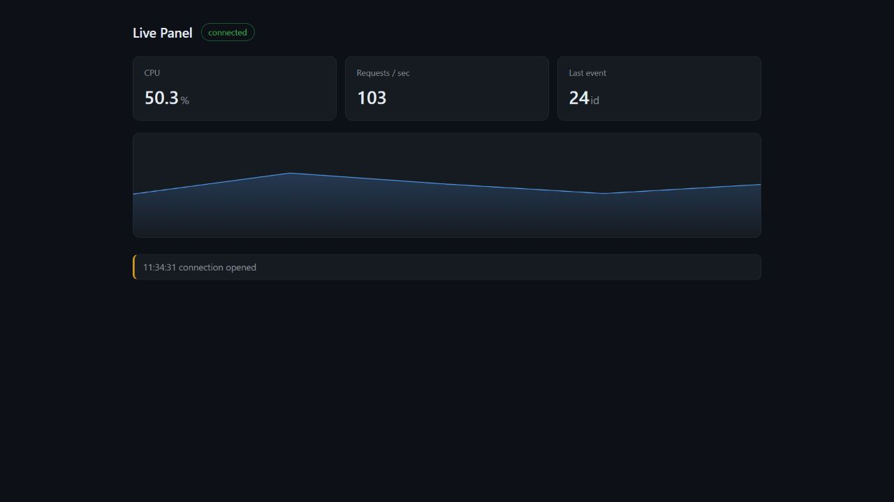

# SSE Live Panel

Server-Sent Events with ASP.NET Core: one HTTP request stays open, the server keeps writing into it, and the browser updates without a page refresh. No WebSocket, no SignalR, no polling.



## What it demonstrates

| | |
| --- | --- |
| Live stream | `MetricTicker` produces a fake measurement every second, in the background |
| One producer, many clients | Every connected client sees the same value at the same moment |
| Automatic reconnection | If the connection drops, `EventSource` reconnects on its own |
| Resume where you left off | The browser sends the last `id` it saw as `Last-Event-ID`, and the server reports how many events were missed |

## Running

```bash
dotnet run
```

The browser opens at <http://localhost:5194>; the address is printed to the console as well. To watch the raw protocol:

```bash
curl -N http://localhost:5194/events
```

## Endpoints

| Endpoint | What it does |
| --- | --- |
| `GET /` | The panel |
| `GET /events` | The event stream (`text/event-stream`) |
| `GET /clients` | How many clients are connected |

## What travels on the wire

```text
event: tick
data: {"cpu":47.2,"requests":188}
id: 29

```

A field name, a colon, a value, and a blank line that ends the event. That is the whole protocol.

## After a disconnect

A client that comes back with the `Last-Event-ID` header gets this first:

```text
event: resume
data: {"missed":23}
```

This event carries no `id`, because it is information rather than data.

If the server is restarted, the counter resets and the server has no history, so `missed` is `0`. To see a real gap, the connection has to drop while the server stays up.

## Worth trying

Run `curl -N http://localhost:5194/events` in three terminals; all three see the same `id`s. Close one and refresh `/clients`: the number drops.

In the panel, open DevTools, go to `Network`, switch to `Offline`, wait five seconds and switch back to `Online`: the panel recovers and logs a `resume` message.

## Notes

- The counter and the client list live in memory. Restarting the process clears both; a multi-instance deployment needs a shared store such as Redis or a database.
- Queues are unbounded. Bounding them for slow clients is a separate design decision.
- SSE is one-way. Sending data from the client to the server uses a normal `POST`.

## License

MIT
